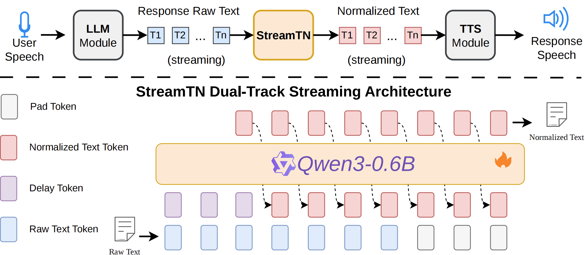

<h1 align="center">StreamTN</h1>

<p align="center">
  <b>A Low-Latency Streaming Chinese Text Normalization Model for Streaming TTS in Dialogue Systems</b>
</p>

<p align="center">
  <b>0.6B LM · Dual-Track Streaming · 213 ms First-Packet Delay · Chinese TN Benchmark</b>
</p>

<p align="center">
  English | <a href="README_zh.md">简体中文</a><br>
  <a href="assets/StreamTN_paper.pdf">Paper</a> ·
  <a href="https://supernova-neko.github.io/Stream-TN/">Demo Page</a> ·
  <a href="https://huggingface.co/starstarcat/StreamTN">Hugging Face</a>
</p>

StreamTN is a lightweight Chinese streaming text normalization (TN) model for LLM-centered spoken dialogue systems. It sits between the upstream LLM and the downstream TTS module, converting partial LLM output into TTS-readable Chinese text without waiting for the complete response.

## Overview



*Figure 1. StreamTN in a cascaded spoken dialogue system (top) and its dual-track streaming architecture built on Qwen3-0.6B (bottom).*

In a cascaded dialogue system, the upstream LLM emits text token by token. Waiting for the full sentence before normalization adds roughly 1.4 s of first-packet delay at a typical upstream rate of 20 tokens/s. StreamTN avoids this with a **dual-track streaming framework** built on [Qwen3-0.6B](https://huggingface.co/Qwen/Qwen3-0.6B): input tokens and output tokens are processed on two parallel tracks and fused frame by frame, with a fixed delay. Full-parameter fine-tuning removes the need for prompt engineering and reduces hallucinations compared with rule-based systems and prompted general-purpose LLMs.

- **Streaming by design**: with a 4-frame delay, the model reaches Micro-F1 **0.8937** at a first-packet delay (FPD) of **213 ms** on the 1,262-sample benchmark.
- **No prompt engineering**: the normalized text is generated directly by the fine-tuned model.
- **Compact**: a 0.6B-parameter backbone, loaded with a single `AutoModelForCausalLM.from_pretrained` call.
- **Broad coverage**: the benchmark spans numbers, dates, times, units, currency, chemistry, and mathematical expressions.

Developed by ASLP@NPU (Northwestern Polytechnical University) and Shenzhen Pimei Technology Co., Ltd.

## Demo

The [demo page](https://supernova-neko.github.io/Stream-TN/) hosts the material behind the paper, including:

- **Case studies** across text categories, with reference normalization, baseline outputs, and raw / StreamTN-synthesized audio
- **Delay-frame analysis**, relating the delay setting to accuracy and FPD
- **Supplementary experiments**: latency comparison against non-streaming baselines, full evaluation metrics, the LLM baseline prompt, zero-vector and LoRA ablations, and character-level error analysis

## Installation

Python 3.10 or newer is recommended. Model weights are downloaded from the Hugging Face Hub on first use, so no local model directory is required.

```bash
git clone <repository-url> streamtn_open
cd streamtn_open
pip install -r requirements.txt
```

`wandb` is optional and only needed for training logs:

```bash
pip install wandb
```

## Inference

```bash
python infer_single.py --text "他今天走了12.5公里"
```

```text
Input : 他今天走了12.5公里
Output: 他今天走了十二点五公里
```

Weights are downloaded automatically from [starstarcat/StreamTN](https://huggingface.co/starstarcat/StreamTN) on first use. To use a fork or a local HF model directory, pass `--model` or set `STREAMTN_MODEL_ID`:

```bash
python infer_single.py --model your-org/your-fork --text "电脑的售价是4899元" --device cuda
```

`--device` accepts `auto` (default), `cpu`, `cuda`, `cuda:0`, and similar values.

## Model weights

| Setting | Default | Override |
| :--- | :--- | :--- |
| Inference model | `starstarcat/StreamTN` | `--model` or `STREAMTN_MODEL_ID` |
| Training backbone | `Qwen/Qwen3-0.6B` | `STREAMTN_BACKBONE_ID` |

Both settings accept a Hugging Face repo id or a local directory containing `config.json`, tokenizer files, and `model.safetensors`.

To publish a checkpoint you trained yourself, `tools/prepare_hf_model.py` converts a training-format `model.safetensors` into a standard HF model directory that can be uploaded to the Hub:

```bash
python tools/prepare_hf_model.py --checkpoint /path/to/training/model.safetensors --output hf_release
```

## Training

Training starts from the Qwen3-0.6B backbone. Provide your own JSONL data (one object with a `messages` list per line; see `train_data/example_data` for the format) and set `data_path` in `config/train_stream.jsonl`, then:

```bash
bash train_stream.sh
```

The launch script uses `CUDA_VISIBLE_DEVICES=0,1` with two processes by default; adjust it to match your GPUs. `resume_from_checkpoint` may point to a Hugging Face repo id or a local HF model directory to start from a prepared checkpoint instead of the raw backbone.

## Evaluation

The paper introduces a Chinese TN benchmark with 1,262 test samples. Character-level Micro-F1 is the primary metric because it accepts pronunciation-equivalent variants.

| Configuration | Micro-F1 | Micro-P | FPD |
| :--- | ---: | ---: | ---: |
| StreamTN, streaming (4-frame delay) | 0.8937 | 0.8931 | 213 ms |
| StreamTN, non-streaming | 0.9639 | 0.9620 | — |

The non-streaming variant sees the entire input and sets an accuracy upper bound, but cannot emit anything until the full sequence arrives. Full metrics, latency decomposition, ablations, and error analysis are on the [demo page](https://supernova-neko.github.io/Stream-TN/).

## Citation

```bibtex
@misc{li2026streamtn,
  title  = {StreamTN: A Low-Latency Streaming Chinese Text Normalization Model for Streaming TTS in Dialogue Systems},
  author = {Li, Wenhao and Liang, Jinrui and Zhang, Haoyu and Hu, Jingbin and Ren, Xiaming and Xie, Hanke and Chen, Huakang and Wang, Chengyou and Guo, Dake and Ma, Linhan and Feng, Su and Liu, Houdun and Chen, Yunxiang and Xie, Lei},
  year   = {2026},
  url    = {https://supernova-neko.github.io/Stream-TN/}
}
```
