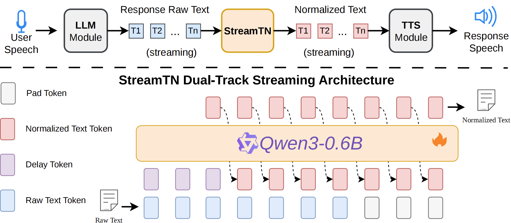

# StreamTN

**StreamTN：面向流式 TTS 对话系统的低延迟中文流式文本正则化模型**

[English](README.md) | [简体中文](README_zh.md)

| **论文** | **Demo 页面** | **Hugging Face** |
| :---: | :---: | :---: |
| [PDF](assets/StreamTN_paper.pdf) | [补充实验](https://supernova-neko.github.io/Stream-TN/) | [starstarcat/StreamTN](https://huggingface.co/starstarcat/StreamTN) |

StreamTN 是面向以大语言模型为中心的口语对话系统的轻量级中文流式文本正则化（Text Normalization, TN）模型。它位于上游 LLM 与下游 TTS 模块之间，将 LLM 逐步输出的部分文本转换为可供 TTS 合成的中文文本，无需等待整句生成完毕。

## 概述



*图 1：StreamTN 在级联口语对话系统中的位置（上），以及基于 Qwen3-0.6B 的双轨流式架构（下）。*

在级联式对话系统中，上游 LLM 逐 token 生成文本。若等整句生成后再做正则化，按典型上游速度 20 tokens/s 计算，首包延迟约为 1.4 秒。StreamTN 基于 [Qwen3-0.6B](https://huggingface.co/Qwen/Qwen3-0.6B)，采用**双轨流式框架**：输入 token 与输出 token 在两条并行轨道上逐帧处理并融合，通过固定延迟帧数控制时延与准确率。全参数微调无需提示词工程，相比规则系统与通用 LLM 提示方案，可减少幻觉并提升正则化效果。

- **原生流式**：4 帧延迟配置下，在 1,262 条测试样本上取得 Micro-F1 **0.8937**，首包延迟（FPD）**213 ms**。
- **无需提示词**：归一化文本由微调后的模型直接生成。
- **模型轻量**：0.6B 参数量底座，一次 `AutoModelForCausalLM.from_pretrained` 即可加载。
- **覆盖广泛**：评测涵盖数字、日期、时间、计量单位、金额、化学与数学表达式等场景。

由西北工业大学 ASLP@NPU 与 Shenzhen Pimei Technology Co., Ltd. 共同完成。

## 在线 Demo

[Demo 页面](https://supernova-neko.github.io/Stream-TN/) 提供论文相关材料：

- **样例展示**：各类文本的原始输入、参考归一化结果、基线输出，以及原始音频与 StreamTN 合成音频
- **延迟帧分析**：不同延迟配置与准确率、FPD 的关系
- **补充实验**：与非流式基线的延迟对比、完整评测指标、LLM 基线提示词、零向量消融、LoRA 消融、字符级错误分析

## 安装

推荐 Python 3.10 及以上版本。权重在首次使用时自动从 Hugging Face 下载，不需要本地模型目录。

```bash
git clone <repository-url> streamtn_open
cd streamtn_open
pip install -r requirements.txt
```

`wandb` 为可选依赖，仅用于训练日志：

```bash
pip install wandb
```

## 推理

```bash
python infer_single.py --text "他今天走了12.5公里"
```

```text
Input : 他今天走了12.5公里
Output: 他今天走了十二点五公里
```

权重首次使用时自动从 [starstarcat/StreamTN](https://huggingface.co/starstarcat/StreamTN) 下载。若要使用自己的 fork 或本地 HF 模型目录，可通过 `--model` 或环境变量 `STREAMTN_MODEL_ID` 覆盖：

```bash
python infer_single.py --model your-org/your-fork --text "电脑的售价是4899元" --device cuda
```

`--device` 支持 `auto`（默认）、`cpu`、`cuda`、`cuda:0` 等取值。

## 模型权重

| 配置 | 默认值 | 覆盖方式 |
| :--- | :--- | :--- |
| 推理模型 | `starstarcat/StreamTN` | `--model` 或 `STREAMTN_MODEL_ID` |
| 训练底座 | `Qwen/Qwen3-0.6B` | `STREAMTN_BACKBONE_ID` |

两者均可填 Hugging Face repo id，或包含 `config.json`、tokenizer 文件与 `model.safetensors` 的本地目录。

若要发布自己训练得到的权重，`tools/prepare_hf_model.py` 可将训练格式的 `model.safetensors` 转换为标准 HF 模型目录，便于上传到 Hub：

```bash
python tools/prepare_hf_model.py --checkpoint /path/to/training/model.safetensors --output hf_release
```

## 训练

训练从 Qwen3-0.6B 底座开始。准备自己的 JSONL 数据（每行一个含 `messages` 列表的对象，格式见 `train_data/example_data`），在 `config/train_stream.jsonl` 中设置 `data_path`，然后运行：

```bash
bash train_stream.sh
```

启动脚本默认使用 `CUDA_VISIBLE_DEVICES=0,1` 与两个进程，请按实际 GPU 数量调整。`resume_from_checkpoint` 可填 Hugging Face repo id 或本地 HF 模型目录，从已准备好的权重而非原始底座开始训练。

## 评测

论文提出了包含 1,262 条测试样本的中文 TN 基准。由于 TTS 场景允许发音等价的不同写法，主指标采用字符级 Micro-F1。

| 配置 | Micro-F1 | Micro-P | FPD |
| :--- | ---: | ---: | ---: |
| StreamTN 流式（4 帧延迟） | 0.8937 | 0.8931 | 213 ms |
| StreamTN 非流式 | 0.9639 | 0.9620 | — |

非流式版本能看到完整输入，可视为准确率上界，但必须等整句接收完毕才能输出。完整指标、延迟拆解、消融实验与错误分析见 [Demo 页面](https://supernova-neko.github.io/Stream-TN/)。

## 引用

```bibtex
@misc{li2026streamtn,
  title  = {StreamTN: A Low-Latency Streaming Chinese Text Normalization Model for Streaming TTS in Dialogue Systems},
  author = {Li, Wenhao and Liang, Jinrui and Zhang, Haoyu and Hu, Jingbin and Ren, Xiaming and Xie, Hanke and Chen, Huakang and Wang, Chengyou and Guo, Dake and Ma, Linhan and Feng, Su and Liu, Houdun and Chen, Yunxiang and Xie, Lei},
  year   = {2026},
  url    = {https://supernova-neko.github.io/Stream-TN/}
}
```
